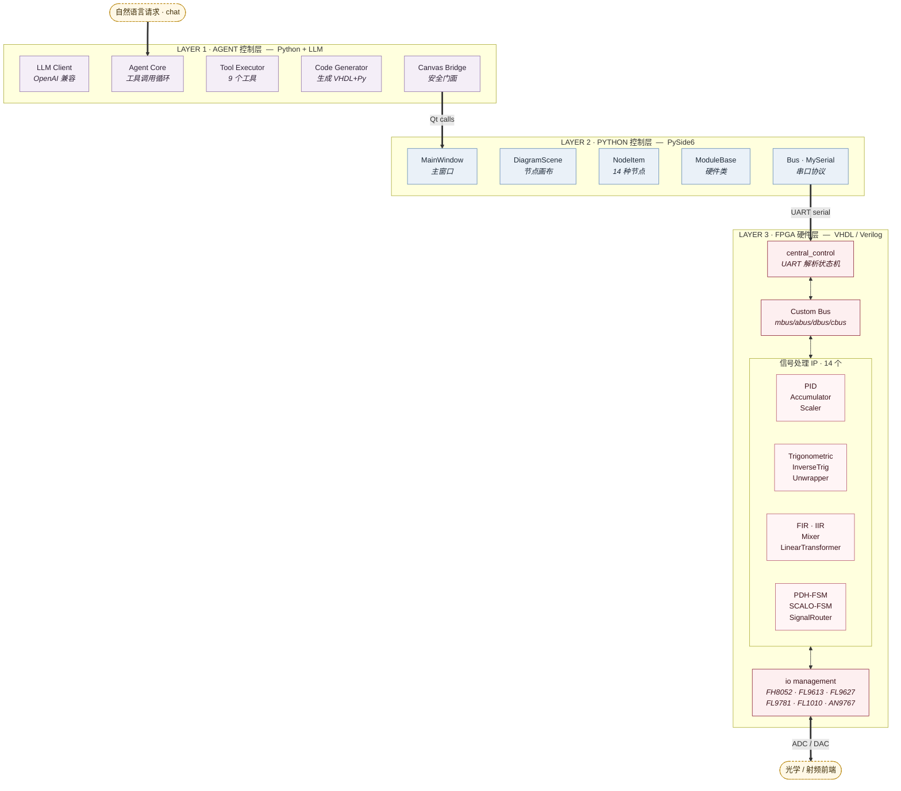
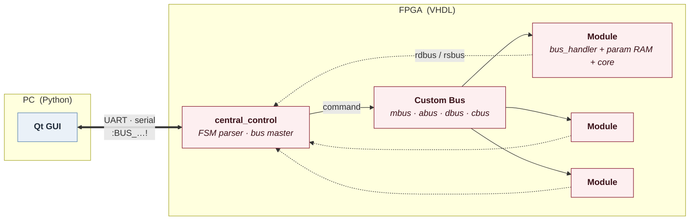
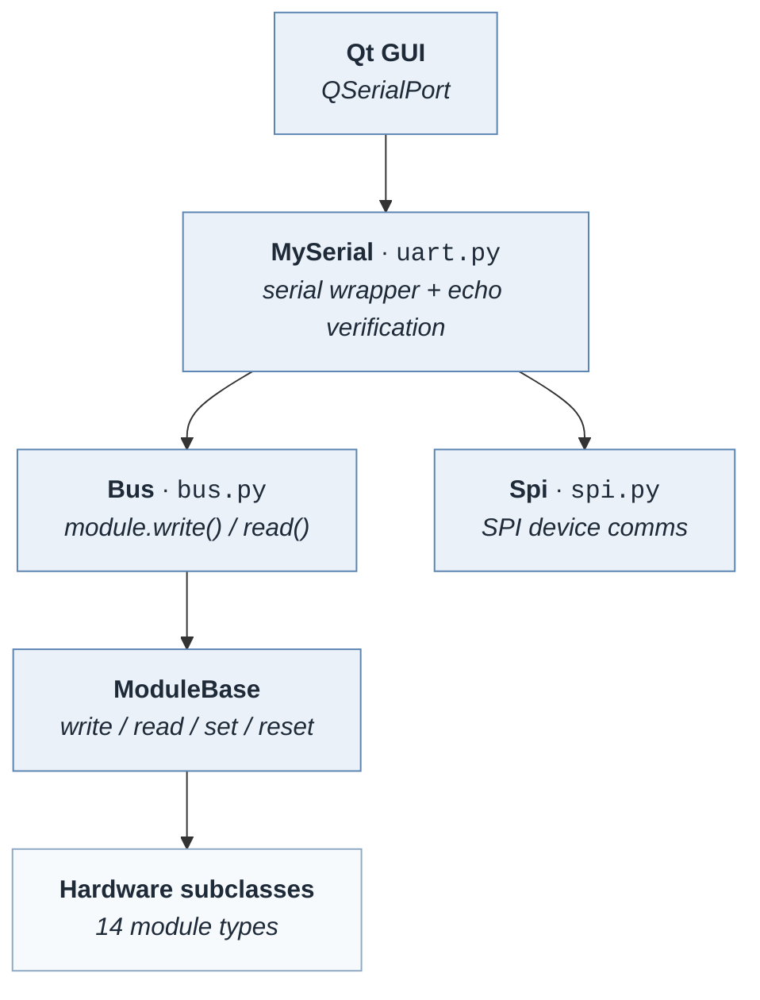
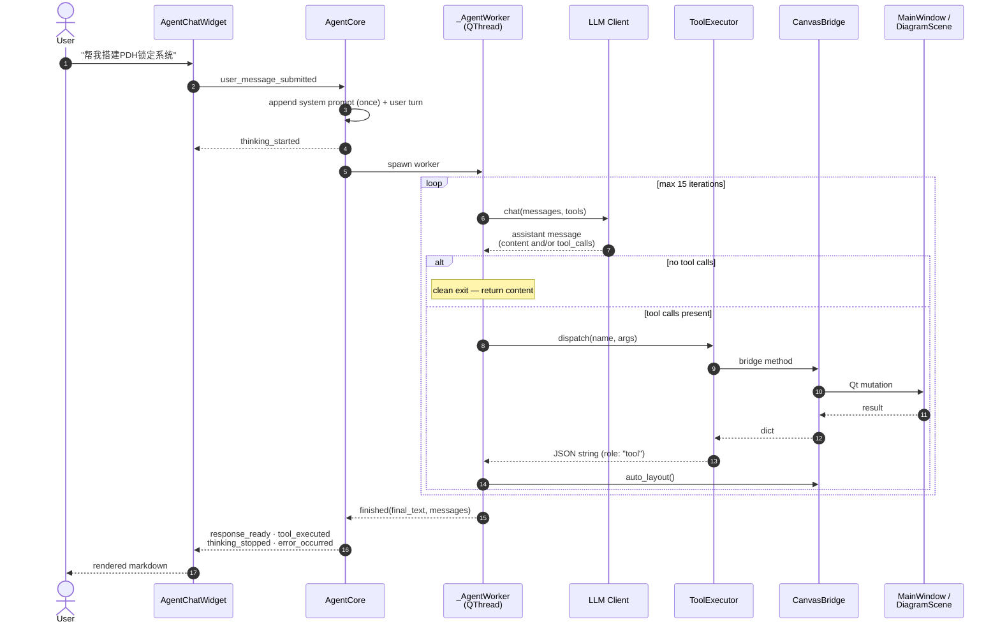
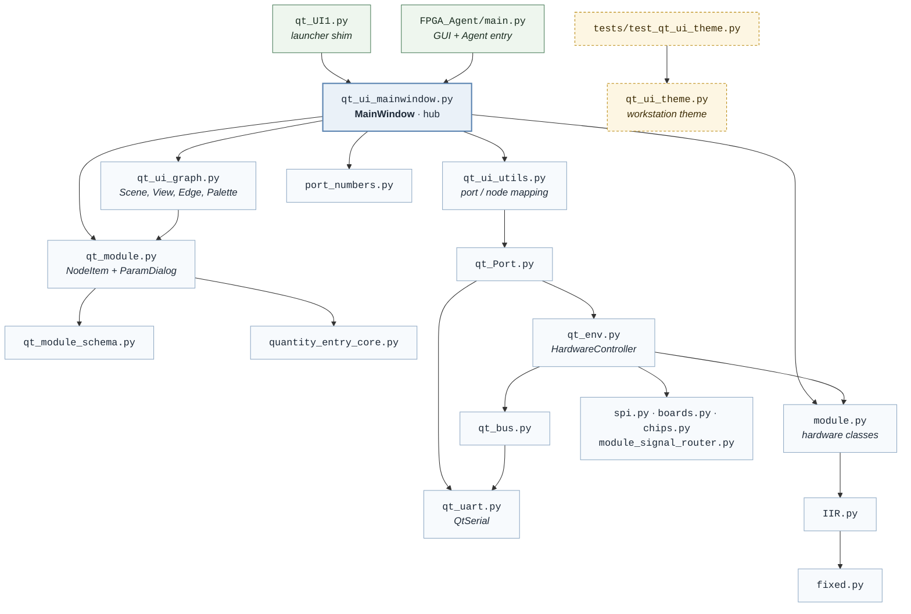
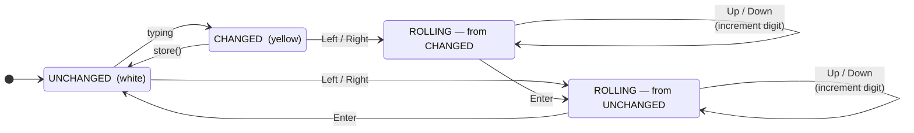
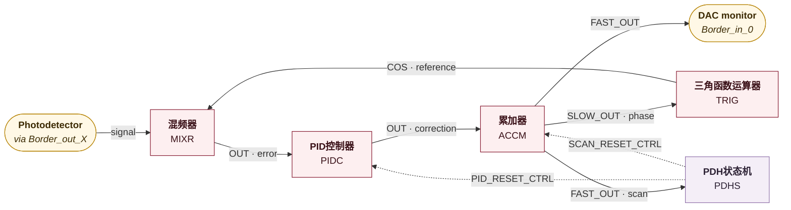

# FPGA Agent — AI-Powered FPGA Signal Processing Design System

An AI-assisted visual design environment for FPGA-based signal processing systems, built around a dual optical comb feedback locking (DClocking) engine running on Xilinx Kintex UltraScale FPGAs. Combines PySide6 visual node editor, LLM function-calling agent, UART/SPI hardware communication, and an extensive VHDL signal processing IP library.

---

## System Architecture (Three-Layer Stack)

Three layers, each a distinct authoring surface. You write natural language at
the top, Python at the middle, and VHDL at the bottom.



**每层的编写对象：** Layer 1 写工具 schema 与系统提示词，Layer 2 写节点类
`NodeItem`、参数 schema 与硬件类 `ModuleBase`，Layer 3 写 IP core、module
wrapper 与 XDC 约束。搭一个新模块需要三层都动，参见
`.agents/skills/integrating-dclocking-layers/`。

| 层 | 代码位置 | 规模 | 核心组件 |
|----|---------|------|---------|
| Layer 1 · Agent | `FPGA_Agent/` | 3,308 行 | Agent Core · LLM Client · Tool Executor · Code Generator · Canvas Bridge |
| Layer 2 · Python | `python control/` | 11,531 行 | MainWindow · DiagramScene · NodeItem · ModuleBase · Bus · MySerial |
| Layer 3 · FPGA | `modules/` `io management/` | 14 IP + 7 适配器 | central_control · Custom Bus · bus_handler · parameter_ram |

依赖严格单向：Layer 1 导入 Layer 2，Layer 2 对 Layer 1 零引用。

**Layer 3 清单。** 14 个 IP：PID, Accumulator, Trigonometric, InverseTrig,
Scaler, FIR, IIR, LinearTransformer, Mixer, Unwrapper, PDH-FSM, SCALO-FSM,
SignalRouter, WaveformStorage。7 个适配器：FH8052, FH9767D, FL9613, FL9627,
FL9781, FL1010, AN9767。

### Layer 1: AI Agent
Natural language understanding layer. Takes user requests in Chinese or English, orchestrates LLM function-calling to manipulate the visual canvas, and generates new VHDL+Python module code on demand.

### Layer 2: Qt GUI
Visual node graph editor for FPGA signal routing. Provides drag-and-drop module placement, interactive parameter dialogs, and real serial communication with hardware via UART.

### Layer 3: FPGA Fabric
The actual hardware implementation. A custom bus protocol routes commands from UART through a central parser FSM to individual signal processing modules. Each module wraps a DSP core with parameter RAM and bus handler.

---

## Project File Structure (Complete)

The outer repository is a thin shell: documentation, a standalone widget, and
verification artifacts. The entire engineering tree lives in the `DClocking/`
submodule.

The graduate thesis that documents this system lives in a **separate repository**
at `../Thies/Thesis/` (six chapters under `毕业论文初稿/`, plus `蒋政毕业设计提纲.md`).
See [Thesis Chapter Mapping](#thesis-chapter-mapping) for how its chapters map
onto the layers of this codebase.

```
FPGA_Agent/
│
├── README.md                          # This file
├── .gitignore                         # Ignores .venv/ __pycache__/ *.pyc
├── .gitmodules                        # Submodule → hosinonisiki/DClocking
├── .claude/settings.local.json        # Bash permission allowlist (no hooks/agents)
│
├── QuantityEntry.py                   # Standalone Tkinter numeric entry widget
│                                      # (586 lines) unit-prefix parsing + roll-edit
│                                      # Legacy — superseded by quantity_entry_core.py
│
├── saved_configs/                     # Pre-change diagram snapshots (rollback captures)
│   └── dclocking_before_pid_*.json    # Taken before PID live-restart testing
│
├── test_artifacts/                    # E2E verification evidence (screenshots)
│   ├── fir_designer_*.jpeg            # FIR designer workbench + live impulse
│   ├── iir_designer_*.jpeg            # IIR designer workbench + inspector
│   ├── pid_doubleclick_*.png          # PID reactivate + live curve
│   ├── pid_response_expand*.jpeg      # PID response expand/expanded window
│   └── custom-blackbox-*.jpg/.json    # Custom blackbox + composite workbench
│
└── DClocking/                         # Git submodule — core FPGA design
    │                                   # + Python control + AI Agent
    ├── LICENSE                        # MIT License (submodule upstream)
    │
    ├── Top.vhdl                       # FPGA top-level entity (871 lines)
    ├── KU060_custom.xdc               # XDC constraints for KU060 custom board
    ├── cdc_sync.vhdl / .xdc           # Clock domain crossing synchronizer
    ├── async_fifo.vhdl / .xdc         # Async FIFO for clock domain crossing
    ├── debouncer.vhdl                 # Signal debouncer
    │
    ├── main_control.vhdl              # Top-level control (MicroBlaze AXI Lite)
    ├── central_control.vhdl           # UART command parser FSM (829 lines)
    │                                   # 20+ states: idle→fetch→parse→bus→respond
    ├── bus_handler.vhdl               # Per-module bus handler FSM
    │                                   # Handles: write/read/control commands
    ├── response_mux.vhdl              # Multiplexes response data from modules
    ├── parameter_ram.vhdl             # Configurable parameter RAM (per module)
    ├── sys_mmcm_sel_ctrl.vhdl         # MMCM clock selection control
    │
    ├── uart_tx.vhdl                   # UART transmitter
    ├── uart_rx.vhdl                   # UART receiver
    ├── uart_axi_master.vhdl           # UART to AXI master bridge
    ├── spi_trx.vhdl                   # SPI transceiver
    ├── spi_task_control.vhdl          # SPI task sequencer
    │
    ├── wrapper.vhdl                   # Top wrapper (default board)
    ├── wrapper_PZ-KU060-FHT.vhdl      # Top wrapper for PZ-KU060-FHT board
    ├── wrapper_KU060_custom.v         # Top wrapper for KU060 custom board
    │
    ├── FPGA_Agent/                    # ★ AI Agent layer (Python + LLM) — 3,308 lines
    │   ├── __init__.py                #    3  docstring only
    │   ├── config.json                #   13  LLM endpoint, API key, model (untracked)
    │   ├── main.py                    #  126  Entry point — assembles GUI + docks Agent
    │   ├── agent_core.py              #  267  AgentCore + _AgentWorker(QThread) loop
    │   ├── agent_chat_widget.py       #  316  Dockable chat panel + LLM settings dialog
    │   ├── canvas_bridge.py           #  366  Safe facade — the ONLY file touching Qt canvas
    │   ├── llm_client.py              #  141  OpenAI-compatible /chat/completions client
    │   ├── tool_definitions.py        #  381  TOOLS list — 9 function-calling JSON Schemas
    │   ├── tool_executor.py           #  170  dispatch() → 9 _handler methods → JSON strings
    │   ├── module_registry.py         #  678  Module catalog, signal-compat matrix,
    │   │                              #       PDH topology; build_llm_context() renders prompt
    │   ├── code_generator.py          #  716  Generates VHDL core + wrapper + hw class +
    │   │                              #       NodeItem + schema; allocates & persists ports
    │   ├── chat_styles.py             #  140  Six Qt stylesheet constants for chat panel
    │   ├── prompts/
    │   │   └── system_prompt.txt      #   82  LLM system prompt (topology reference)
    │   └── generated/                 # Output directory for code generation
    │       ├── __init__.py            # 1-line stub — runtime append target
    │       ├── schemas.py             # 1-line stub — parameter schemas appended here
    │       ├── hw_classes.py          # 1-line stub — ModuleBase subclasses appended here
    │       ├── node_classes.py        # 1-line stub — NodeItem subclasses appended here
    │       ├── port_map.json          # Port number allocation tracking
    │       └── modules/               # Per-module generated VHDL files
    │
    ├── python control/                # ★ Qt GUI layer (PySide6) — 11,531 lines, 28 files
    │   │
    │   │  ── Active GUI core ──
    │   ├── qt_module.py               # 2371  Largest file. NodeItem + per-module subclasses,
    │   │                              #       PortItem + signal markers, ParamDialog,
    │   │                              #       PIDParamCanvas, CompositeModule, module_factory
    │   ├── qt_ui_mainwindow.py        # 1431  MainWindow — THE real entry point.
    │   │                              #       Menus, palette, canvas hosting, serial connect,
    │   │                              #       sync, routing, diagram JSON save/load
    │   ├── qt_ui_graph.py             # 1178  DiagramScene, DiagramView, EdgeItem, BorderPort,
    │   │                              #       NodeSignals, ComponentPalette
    │   ├── qt_ui_theme.py             #  435  ★ NEW (HEAD commit) workstation theme:
    │   │                              #       UiColors, build_application_stylesheet(),
    │   │                              #       apply_application_theme(), draw_node_chrome()
    │   │                              #       ⚠ NOT YET IMPORTED by any GUI file
    │   ├── qt_ui_utils.py             #  255  Port mapping, node mapping, shared helpers
    │   ├── qt_module_schema.py        #  176  8 param schemas (PID/ACCM/SCLR/FIRF/
    │   │                              #       LTRN/PDH/SCLO/IIR)
    │   ├── qt_UI1.py                  #   18  Launcher shim (valid via __main__)
    │   │
    │   │  ── Hardware control (GUI-independent) ──
    │   ├── module.py                  #  793  ModuleBase + hardware classes, numpy/scipy DSP
    │   │                              #       ModulePID, ModuleAccumulator, ModuleScaler,
    │   │                              #       ModuleFIRFilter, ModuleIIRFilter,
    │   │                              #       ModuleLinearTransformer, ModulePDHFSM,
    │   │                              #       ModuleSCLOFSM
    │   │                              #       (TRIG/ATAN/MIXR/UNWR use ModuleBase directly)
    │   ├── quantity_entry_core.py     #  431  QuantityEntryCore + QuantityFormat (Qt version)
    │   ├── qt_Port.py                 #  404  Port abstraction → qt_env.HardwareController
    │   ├── fixed.py                   #  367  Fixed-point arithmetic type
    │   ├── chips.py                   #  346  Chip register definitions over SPI
    │   ├── qt_env.py                  #  310  HardwareController (Qt-side environment)
    │   ├── qt_uart.py                 #  155  QtSerial
    │   ├── IIR.py                     #  153  IIR filter design (scipy)
    │   ├── port_numbers.py            #  137  Hardware port number constants
    │   ├── uart.py                    #  128  MySerial — pyserial transport
    │   ├── module_signal_router.py    #  110  Signal router + matplotlib routing viz
    │   ├── spi.py                     #   46  SPI communication class
    │   ├── qt_bus.py                  #   41  Bus communication widget
    │   ├── bus.py                     #   41  Bus class — serial-to-memory protocol
    │   ├── boards.py                  #   20  Board definitions
    │   ├── fir_coef.txt               #       Default FIR filter coefficients
    │   │
    │   │  ── Dead code: no importer anywhere (~2,200 lines) ──
    │   ├── qt_Ui.py                   #  773  ⚠ Legacy monolithic GUI, superseded by the
    │   │                              #       mainwindow/graph/module split
    │   ├── KU060chips.py              #  496  ⚠ Parallel to chips.py; only chips.py is used
    │   ├── test.py                    #  311  ⚠ Ad-hoc __main__ script, not pytest-collectable
    │   ├── qt_test.py                 #  311  ⚠ Ad-hoc __main__ script
    │   ├── env.py                     #  269  ⚠ Non-Qt twin of qt_env.py
    │   ├── module_moku_mim_wrapper.py #   25  ⚠ Orphan wrapper
    │   │
    │   ├── readme_qt.md               # Qt GUI module dependency documentation (Chinese)
    │   ├── readme_python.md           # Python control API documentation (Chinese)
    │   ├── 模块搭建说明.md             # Module construction guide (Chinese)
    │   ├── 正弦波发生器构建.md          # Sine generator construction guide (Chinese)
    │   └── FPGAUi.md                  # FPGA UI design notes (Chinese)
    │
    ├── tests/                         # ★ NEW — the repo's only automated tests
    │   ├── test_qt_ui_theme.py        #   48  Asserts theme tokens (e.g. PKU_WINE
    │   │                              #       == "#85172E") + stylesheet build
    │   └── qt_test_support.py         #   20  Offscreen-Qt bootstrap (ensure_app)
    │
    ├── .agents/skills/                # ★ NEW — 4 repo-level Codex Skills (untracked)
    │   │                              #   each: SKILL.md + references/ + agents/openai.yaml
    │   ├── developing-fpga-hardware/  #   VHDL/Verilog, wrappers, clocks, buses, param RAM,
    │   │                              #   UART/SPI, adapters, constraints, timing, bitstreams
    │   │   └── references/            #   architecture.md, module-checklist.md
    │   ├── developing-qt-model-configuration/
    │   │                              #   PySide6 node editor, schemas, factories,
    │   │                              #   port mapping, persistence
    │   │   └── references/            #   architecture.md, module-registration.md
    │   ├── developing-agent-llm/      #   Chat UI, LLM client, prompts, tool schemas,
    │   │                              #   ToolExecutor, CanvasBridge, generated modules
    │   │   └── references/            #   architecture.md, tool-contracts.md
    │   └── integrating-dclocking-layers/
    │                                  #   Cross-layer changes spanning 2+ of
    │                                  #   HDL / control / Qt / Agent
    │       └── references/            #   end-to-end-flows.md, change-impact-matrix.md
    │
    ├── docs/superpowers/              # ★ NEW — in-flight design work (2026-08-13)
    │   ├── plans/
    │   │   ├── 2026-08-13-dclocking-integrated-ui-redesign.md
    │   │   │                          #   ACTIVE (modified). Implement approved B2
    │   │   │                          #   precision-instrument workstation UI while
    │   │   │                          #   preserving routing/param/persistence/Agent contracts
    │   │   └── 2026-08-13-dclocking-project-skills.md
    │   │                              #   Create the 4 Skills above (appears executed)
    │   └── specs/
    │       ├── 2026-08-13-dclocking-integrated-ui-redesign.md
    │       │                          #   DClocking 完整集成界面优化设计
    │       └── 2026-08-13-dclocking-project-skills-design.md
    │                                  #   DClocking 项目级 Skills 设计
    │
    ├── .superpowers/brainstorm/       # ★ NEW — 5 HTML design explorations that
    │                                  #   produced the approved B2 direction
    │
    ├── .worktrees/integrated-ui-redesign/
    │                                  # ★ Live git worktree — UI redesign happens here.
    │                                  #   Branch-only files: requirements.txt,
    │                                  #   requirements-harness.txt, requirements-mcp.txt,
    │                                  #   scripts/, .github/, .tours/
    │
    ├── modules/                       # ★ VHDL signal processing IP cores
    │   ├── pid_controller/            # PID feedback controller
    │   │   ├── pid_controller.vhdl    # Core PID DSP
    │   │   └── module_pid_controller.vhdl  # Module wrapper (bus+param+core)
    │   │
    │   ├── accumulator/               # Phase/frequency accumulator (NCO base)
    │   │   ├── accumulator.vhdl       # Core 64-bit phase accumulator
    │   │   └── module_accumulator.vhdl
    │   │
    │   ├── trigonometric/             # CORDIC sine/cosine
    │   │   ├── trigonometric.vhdl
    │   │   └── module_trigonometric.vhdl
    │   │
    │   ├── inv_trigonometric/         # CORDIC arctangent
    │   │   ├── inv_trigonometric.vhdl
    │   │   └── module_inv_trigonometric.vhdl
    │   │
    │   ├── scaler/                    # Linear scaler (gain + bias + limiting)
    │   │   ├── scaler.vhdl
    │   │   └── module_scaler.vhdl
    │   │
    │   ├── fir_filter/               # 64-tap FIR filter
    │   │   ├── fir_filter.vhdl
    │   │   └── module_fir_filter.vhdl
    │   │
    │   ├── iir_filter/               # IIR biquad filter (2 sections)
    │   │   ├── iir_filter.vhdl
    │   │   └── module_iir_filter.vhdl
    │   │
    │   ├── linear_transformer/       # 2x2 matrix transform
    │   │   ├── linear_transformer.vhdl
    │   │   └── module_linear_transformer.vhdl
    │   │
    │   ├── mixer/                    # Signal multiplier/mixer
    │   │   ├── mixer.vhdl
    │   │   └── module_mixer.vhdl
    │   │
    │   ├── unwrapper/                # Phase unwrapper (2π discontinuity removal)
    │   │   ├── unwrapper.vhdl
    │   │   └── module_unwrapper.vhdl
    │   │
    │   ├── pdh_state_machine/        # PDH lock state machine
    │   │   ├── pdh_state_machine.vhdl
    │   │   └── module_pdh_state_machine.vhdl
    │   │
    │   ├── SCALO_state_machine/      # LO auto-calibration state machine
    │   │   ├── SCALO_state_machine.vhdl
    │   │   └── module_SCALO_state_machine.vhdl
    │   │
    │   ├── signal_router/            # Crossbar switch (64 data + 64 control ports)
    │   │   ├── signal_router.vhdl
    │   │   └── module_signal_router.vhdl
    │   │
    │   ├── data_logger/              # ⚠ EMPTY STUB — data_logger.vhdl is 0 bytes,
    │   │   └── data_logger.vhdl      #   no core logic, no module wrapper
    │   │
    │   ├── ethernet_interface/       # ⚠ INCOMPLETE — core only (104 lines),
    │   │   └── ethernet_interface.vhdl  #   module_ethernet_interface.vhdl missing
    │   │
    │   ├── moku_mim_wrapper/         # Moku MIM wrapper
    │   │   ├── moku_mim_wrapper.vhdl
    │   │   ├── mcc_wrapper.vhdl
    │   │   ├── module_moku_mim_wrapper.vhdl
    │   │   └── bus_handler_moku_mim_wrapper.vhdl
    │   │
    │   └── waveform_storage_upload/  # DDR4 capture + Ethernet upload
    │       │                         # ⚠ Does NOT follow the core/wrapper convention.
    │       │                         # 10,825 lines across 42 .v files — ~50% of all
    │       │                         # module-layer HDL. No module wrapper.
    │       ├── storage_upload_top.v  # Entry point (473 lines)
    │       ├── MainController.v
    │       ├── Memctrl_top.v
    │       ├── DDR4ControllerWrapper.v
    │       ├── oscilloscope.v
    │       ├── mem_ethernet_top.v
    │       ├── TriggerDetector.v
    │       ├── ChannelTriggerDetector.v
    │       ├── AdvancedTriggerHandler.v
    │       ├── DataPreprocessor.v
    │       ├── adc_sample.v
    │       ├── frame_read_write.v
    │       ├── frame_fifo_write.v
    │       ├── frame_fifo_read.v
    │       ├── aq_axi_master.v
    │       └── eth_src/              # Ethernet MAC stack
    │           ├── ethernet_test.v
    │           ├── util_gmii_to_rgmii.v
    │           ├── mdio/             # MDIO (SMI) PHY management
    │           │   ├── smi_read_write.v
    │           │   └── smi_config.v
    │           ├── arbi/             # GMII arbitration
    │           │   ├── gmii_arbi.v
    │           │   ├── gmii_rx_buffer.v
    │           │   └── gmii_tx_buffer.v
    │           └── mac/              # MAC layer
    │               ├── mac_top.v, mac_ctrl.v, eth_top.v
    │               ├── eth_cmd.v, crc.v, icmp_reply.v
    │               ├── arp_cache.v
    │               ├── tx/           # TX path
    │               │   ├── mac_tx_top.v, mac_tx.v, mac_tx_mode.v
    │               │   ├── ip_tx.v, ip_tx_mode.v
    │               │   ├── udp_tx.v, arp_tx.v, dhcp_tx.v
    │               └── rx/           # RX path
    │                   ├── mac_rx_top.v, mac_rx.v
    │                   ├── ip_rx.v, udp_rx.v, arp_rx.v
    │
    ├── io management/                # ★ ADC/DAC board adapters
    │   ├── FH8052_adapter.vhdl       # 14-bit 250MSPS dual ADC
    │   ├── FH8052_adapter.xdc
    │   ├── FH9767D_adapter.vhdl      # 14-bit 200MSPS dual ADC
    │   ├── FL9613_adapter.vhdl       # 16-bit 250MSPS dual ADC/DAC
    │   ├── FL9613_adapter.xdc
    │   ├── FL9627_adapter.vhdl       # 16-bit 500MSPS dual DAC
    │   ├── FL9627_adapter.xdc
    │   ├── FL9781_adapter.vhdl       # 14-bit 1GSPS dual ADC
    │   ├── FL1010_adapter.vhdl       # 10-bit 5GSPS ADC
    │   ├── AN9767_adapter.vhdl       # 14-bit dual DAC
    │   ├── adc_axis_rx.vhdl          # ADC AXI Stream receiver
    │   ├── dac_axis_tx.vhdl          # DAC AXI Stream transmitter
    │   ├── fir_filter_upsample_4.vhdl # 4x upsampling FIR for DAC
    │   └── ADDC/                     # ADDC board (high-speed ADC/DAC)
    │       ├── board_ku060_adda_top.v
    │       ├── transport128.v
    │       ├── transport.v
    │       ├── dac_axis256_tx.vhdl
    │       ├── spi_3_if.v
    │       ├── spi_3_if_ch16_v1_0_S00_AXI.v
    │       └── board_ku060_ad1Gda500M_prj.elf  # MicroBlaze FW
    │
    ├── packages/                     # VHDL package files
    │   ├── mypak.vhdl                # Main package: types, constants, bus defs
    │   ├── bus_protocol.vhdl         # Bus protocol constants and types
    │   ├── uart_protocol.vhdl        # UART protocol constants
    │   ├── ethernet_protocol.vhdl    # Ethernet protocol constants
    │   ├── moku_mim_config.vhdl      # Moku MIM configuration
    │   ├── PZ_KU060_config.vhdl      # PZ-KU060 board config
    │   └── KU060_custom_config.vhdl  # KU060 custom board config
    │
    ├── templates/                    # VHDL code templates
    │   ├── module_template.vhdl      # Module wrapper template
    │   └── core_template.vhdl        # Module core template
    │
    ├── python tools/                 # Build & config tools
    │   ├── chip_configuration.py     # Chip configuration manager
    │   ├── configuration_list.py     # Configuration list definitions
    │   ├── testbench_script.py       # Testbench automation
    │   └── wrapper.vhdl              # Generated wrapper
    │
    ├── products/                     # Built bitstreams
    │   ├── wrapper.bit.out_of_date   # Default board bitstream
    │   ├── wrapper_KU060_custom.bit  # KU060 custom board bitstream
    │   ├── wrapper.ltx               # Debug probes (default)
    │   └── wrapper_KU060_custom.ltx  # Debug probes (KU060 custom)
    │
    └── UI界面需求.md                 # UI requirements document (Chinese)
```

---

## Signal Processing Module Catalog

Each module follows a uniform architecture: **VHDL core** → **module wrapper** (bus_handler + parameter_ram) → **Python hw class** → **Python Qt NodeItem class**.

### Module Naming Convention

- **Display Name** (Chinese): used in UI, e.g., `PID控制器`, `累加器`
- **Internal Names** (short): used in tool calls, e.g., `PIDC`/`PID2`, `ACCM`/`ACC2`
- **First instance** uses the base name; subsequent instances append `2`, `3`, `4`

### Signal Type System

Markers are drawn by `PortItem._draw_signal_markers` in `qt_module.py`:

| Signal Type | Visual Mark | Compatible Inputs | Description |
|-------------|-------------|-------------------|-------------|
| `level` | Pentagram | level, phase, differential | Generic amplitude |
| `phase` | Circle | phase only | Phase-domain values |
| `differential` | Diamond | level, differential | Phase differences |
| `bool` | Square | bool only | 1-bit control |

Unrecognized signal names fall through to a small triangle (`unknown`).

### Module Reference Table

| # | Display Name | Internal | Max | Inputs | Outputs | Category |
|---|-------------|----------|-----|--------|---------|----------|
| 1 | PID控制器 | PIDC, PID2 | 2 | 2 (reset:bool, error:level/phase) | 1 (feedback:level/diff) | control |
| 2 | 累加器 | ACCM, ACC2 | 2 | 5 (error, bias, reset, pause, lf_reset) | 2 (slow, fast) | signal_gen |
| 3 | 三角函数运算器 | TRIG..TRI4 | 4 | 1 (phase:phase) | 2 (sin, cos:level) | math |
| 4 | 反三角函数运算器 | ATAN, ATA2 | 2 | 2 (sin, cos:level) | 1 (phase:phase) | math |
| 5 | 线性缩放器 | SCLR..SCL4 | 4 | 1 (any physical) | 1 (any physical) | conditioning |
| 6 | FIR滤波器 | FIRF..FIR4 | 4 | 1 (level/diff) | 1 (level/diff) | filter |
| 7 | IIR滤波器 | IIRF..IIR4 | 4 | 1 (level/diff) | 1 (level/diff) | filter |
| 8 | 线性变换器 | LTRN, LTR2 | 2 | 2 (A,B:level/diff) | 2 (A,B:level/diff) | math |
| 9 | 混频器 | MIXR..MIX4 | 4 | 2 (A,B:level) | 1 (level/diff) | math |
| 10 | 解卷绕器 | UNWR | 1 | 1 (phase:phase) | 1 (phase:phase) | conditioning |
| 11 | PDH状态机 | PDHS | 1 | 2 (power, scan:level) | 3 (pid, mixer, scan:bool) | control |
| 12 | LO自动校准状态机 | SCLO, SLO2 | 2 | 1 (phase:phase) | 2 (bias:diff, pid:bool) | control |
| — | 布尔值：是 | HIGH1..5 | ∞ | 0 | 1 (bool: HIGH) | constant |
| — | 布尔值：否 | LOW1..5 | ∞ | 0 | 1 (bool: LOW) | constant |

### Composite Modules

| Display Name | Contains | Auto-Connections |
|-------------|----------|------------------|
| 正弦波发生器 | 累加器 + 三角函数运算器 | ACCM.FAST_OUT(1) → TRIG.IN(0) |
| 数字控制振荡器 | 累加器 + 2×三角函数运算器 | Manual wiring |

### Border Ports (System I/O)

- **输出通道A–H** (`Border_in_0..7`): ADC inputs to FPGA → appear as canvas sinks
- **输入通道A–H** (`Border_out_0..7`): DAC outputs from FPGA → appear as canvas sources
- Each accepts all signal types: bool, level, phase, differential

---

## Bus Protocol & Hardware Communication

### On-Chip Bus Architecture



**Bus signals:**
- `mbus` — module selection bus (which module is addressed)
- `abus` — address bus (memory location within module)
- `dbus` — data bus (value to write)
- `cbus` — control bus (read/write/control commands + misc flags)
- `rdbus` — response data bus (returned value)
- `rsbus` — response status bus (status/error flags)

### Serial Command Protocol

Commands are ASCII-framed with `:` start and `!` end delimiters, with `.` segment separators:

```
:BUS_.[MODULE].[OP].[FIELD].[VALUE]...[HOLD]!
```

**Example — write to PID controller:**
```
:BUS_.PIDC.WRTE.ADDR.\x00\x00\x00\x02.DATA.\x00\x00\x40\x00!
```
Writes value `0x00004000` (16384) to address 2 (gain_d) of module `PIDC`.

**Response format:**
- `:ACKN!` — command executed successfully
- `:ERR_.ERRTYPE!` — parse/execution error
- Read responses: `:ACKN.DATA.\x...!` — followed by 4-byte read data

**Operation types:**
- `WRTE` — write data to module memory
- `READ` — read data from module memory
- `CTRL` — control commands (reset, set reset, etc.)

### Python Communication Stack



**Subclasses:** `ModulePID`, `ModuleAccumulator`, `ModuleScaler`, `ModuleFIRFilter`,
`ModuleIIRFilter`, `ModuleLinerTransformer`, `ModuleSignalRouter` (256-port crossbar),
`ModulePDHFSM`, `ModuleSCLOFSM`. TRIG, ATAN, MIXR, and UNWR use `ModuleBase` directly.

**Parameter addressing:**
- Each module has a `parameter_list` dict mapping addresses → {name, width}
- Direct parameters: raw register writes (int address + int data)
- Indirect parameters: Python-side transforms → multiple register writes
- Boolean parameters (width=1): `set()` for level, `flip_on()`/`flip_off()` for edge

---

## AI Agent — Detailed Architecture

### Component Flow



### 9 Agent Tools

| Tool | Description |
|------|-------------|
| `create_module` | Place a new signal processing module on canvas |
| `connect_modules` | Wire an output port to an input port |
| `disconnect_module` | Remove a connection or an entire node |
| `list_modules` | List available types and/or canvas state |
| `set_parameter` | Set module parameters (writes to HW if connected) |
| `get_module_info` | Get detailed port/parameter info for a module type |
| `generate_module` | Generate VHDL+Python code for a new custom module |
| `auto_layout` | Auto-arrange nodes with layered graph layout |
| `clear_canvas` | Remove all modules and connections |

### LLM Client

- **Protocol**: OpenAI-compatible `/chat/completions` endpoint
- **Tool calling**: Standard `tool_choice: "auto"` with function-calling JSON Schema
- **Supported backends**: OpenAI, DeepSeek, Anthropic (via proxy), Ollama, vLLM
- **Config** (`config.json`):
```json
{
  "llm": {
    "endpoint": "https://api.deepseek.com/v1",
    "api_key": "sk-...",
    "model": "deepseek-chat",
    "temperature": 0.1,
    "max_tokens": 4096
  },
  "agent": {
    "max_tool_iterations": 15,
    "auto_layout_after_create": true
  }
}
```

### Canvas Bridge (Safe Facade)

The `CanvasBridge` wraps Qt's `MainWindow`/`DiagramScene`/`DiagramView` internals behind a clean Python dict API. No agent code touches Qt widgets directly. Operations:
- `create_node(component_name, position?, params?)` → {success, node_name, ...}
- `create_connection(src, src_port, dst, dst_port)` → {success, connection}
- `list_nodes()` / `list_connections()` → [{name, position, ports, ...}]
- `get_port_info(node_name)` → {inputs: [{index, signals, connected}], outputs: [...]}
- `get_node_params()` / `set_node_params()`
- `remove_node(node_name)` / `disconnect_input(node_name, port_idx)` → back the `disconnect_module` tool
- `clear_canvas()` / `auto_layout()` / `get_canvas_state()` / `set_developer_mode(enabled)`

---

## Qt GUI — Detailed Architecture

### Module Dependency Graph

`qt_ui_mainwindow.py` is the hub, importing six siblings. Both entry points
(`qt_UI1.py` for GUI-only, `FPGA_Agent/main.py` for GUI + Agent) converge on it.



The dashed amber box is `qt_ui_theme.py`: reachable only from its test, not yet
imported by any GUI file. See [Current Status & Known Gaps](#current-status--known-gaps).

### Interaction Flow

1. **Add module**: Drag from right palette → drop on canvas
2. **Connect modules**: Click output port → drag to input port
3. **Move module**: Drag node on canvas
4. **Delete module**: Drag node off canvas to right area
5. **Delete connection**: Click already-connected input port
6. **Set parameters**: Double-click module → ParamDialog
7. **Pan view**: Drag empty canvas area
8. **Zoom view**: Mouse wheel

### NodeItem Classes

Each module type has a specialized `NodeItem` subclass defining:
- `inputs` / `outputs` — port names (e.g., `["ERROR_IN", "BIAS_IN", "RESET"]`)
- `inputs_display_name` — Chinese port labels (e.g., `["外部反馈输入", ...]`)
- `inputs_signals` / `outputs_signals` — signal type arrays
- `schema` — parameter schema for ParamDialog generation
- `num_inputs` / `num_outputs` — port counts
- `maxm` — max instances on canvas

### EdgeItem (Connection Lines)

- **Color**: Inherited from source output port
- **Style**: solid (level), dashed (phase), dash-dot (differential)
- **Width**: thick (physical signal), thin (boolean signal)
- **Path**: Z-shaped auto-routed with collision avoidance

### ParamDialog

- Dynamic form generation from schema
- Supports int, float, bool, str parameter types
- Direct mode: immediate register write
- Indirect mode: Python-side calculation then multi-register write
- PID special: `PIDParamCanvas` — interactive gain curve plot with drag-adjustable markers
- FIR special: `SpecialMethodDialog` — scipy-based filter designer

### Developer Mode

When enabled:
- Physical signal types (level/phase/differential) may interconnect freely
- All parameters become editable (removes `free=False` restrictions)

---

## Code Generation System

When the LLM calls `generate_module`, the `CodeGenerator` produces:

### Generated Files

| File | Content |
|------|---------|
| `generated/modules/<name>/<name>.vhdl` | VHDL core entity skeleton with io buffer logic |
| `generated/modules/<name>/module_<name>.vhdl` | VHDL module wrapper (bus_handler + parameter_ram + core) |
| `generated/hw_classes.py` | Python `ModuleBase` subclass with parameter_list |
| `generated/node_classes.py` | Python `NodeItem` subclass for canvas rendering |
| `generated/schemas.py` | Parameter schema dict for ParamDialog |
| `generated/port_map.json` | Port number allocation tracking |

### VHDL Core Template

Generated cores include:
- Configurable IO buffering (4 modes: buf_for_io, buf_i_only, buf_o_only, buf_none)
- Parameter RAM interface (`core_param_in`)
- Data flow ports for all specified inputs/outputs
- Auto-reset support
- Internal signal buffers with proper clock domain crossing

**Important**: The generated VHDL core is a **skeleton** — the DSP logic between input/output buffers must be filled in manually by a hardware engineer.

### Runtime Registration

After generation, modules are monkey-patched into the running application:
- `module_factory[display_name]` = generated NodeItem class
- `_used_indices`, `_maxnum` updated on the view
- `resolve_port_number` extended to handle new module ports

---

## Standalone QuantityEntry Widget

`QuantityEntry.py` (586 lines) is a standalone Tkinter widget, independent of
Qt/PySide6. It predates the PySide6 UI and is **not used by the application** — the
live equivalent is `python control/quantity_entry_core.py` (431 lines), which carries
the same `QuantityFormat` parsing logic into the Qt GUI. Kept at the repo root as the
reference implementation of the roll-edit interaction.

It provides:

### QuantityFormat

A regex-based parser for scientific/engineering notation:

```
digits limit: (9, 9, 3)  →  9 integer digits, 9 fraction digits, 3 mandatory fraction digits
prefix: {"m": 1e-3, "u": 1e-6, "n": 1e-9, "p": 1e-12, "k": 1e3, "M": 1e6, "G": 1e9, "T": 1e12}
unit: "Hz", "V", etc.
```

**Parse example**: Input `-10.5MHz` → value = `-10500000.0`, formalized = `-10.500MHz`

### QuantityEntry States

The widget has three interaction states modeled as a Finite State Machine:



**Rolling mode**: Select a digit and use Up/Down/Left/Right to increment, decrement, and navigate digit positions. Handles:
- Carry propagation (9→0 wraps leftward)
- Sign flipping (crossing zero flips ±)
- Leading/trailing zero management
- Decimal point insertion/removal
- Trailing zero preservation

### Usage

```bash
python QuantityEntry.py
```

Embeds two example widgets: frequency entry (Hz) and voltage entry (V) with full roll-edit interaction.

---

## Hardware Support

### FPGA Boards

| Board | Wrapper File | Notes |
|-------|-------------|-------|
| PZ-KU060-FHT | `wrapper_PZ-KU060-FHT.vhdl` | Custom FHT board |
| KU060 Custom | `wrapper_KU060_custom.v` / `.bit` | Custom KU060 board |
| Default | `wrapper.vhdl` / `.bit` | Generic board |

### ADC/DAC Adapters

| Adapter | Type | Resolution | Sample Rate |
|---------|------|------------|-------------|
| FH8052 | Dual ADC | 14-bit | 250 MSPS |
| FH9767D | Dual ADC | 14-bit | 200 MSPS |
| FL9613 | Dual ADC/DAC | 16-bit | 250 MSPS |
| FL9627 | Dual DAC | 16-bit | 500 MSPS |
| FL9781 | Dual ADC | 14-bit | 1 GSPS |
| FL1010 | ADC | 10-bit | 5 GSPS |
| AN9767 | Dual DAC | 14-bit | — |
| ADDC | ADC/DAC combo | — | 1G ADC / 500M DAC |

---

## PDH Locking Reference Topology

The canonical Pound-Drever-Hall locking pipeline:



Solid arrows are the signal path; dashed arrows are boolean control from the state
machine. Its sequence: `idle → scan → lock → hold`, with `unlock` on signal loss.

Mapped to tool calls:
```
ACCM.SLOW_OUT(0) → TRIG.IN(0)
TRIG.COS(1) → MIXR.IN_A(0)
[Border_out_X] → MIXR.IN_B(1)         # photodetector
MIXR.OUT(0) → PIDC.IN(1)
PIDC.OUT(0) → ACCM.ERROR_IN(0)
PDHS.PID_RESET_CTRL(0) → PIDC.RESET(0)
PDHS.SCAN_RESET_CTRL(2) → ACCM.RESET(2)
ACCM.FAST_OUT(1) → PDHS.IN_SCAN(1)
ACCM.FAST_OUT(1) → Border_in_0        # DAC monitor
```

---

## Quick Start

### Clone with submodule

The engineering tree is a submodule, so a plain `git clone` leaves `DClocking/` empty:

```bash
git clone --recurse-submodules <repo-url>
# or, if already cloned:
git submodule update --init --recursive
```

### Prerequisites

Developed against Python 3.13.

```bash
pip install PySide6 numpy scipy pyserial pillow matplotlib
```

`pillow` is needed only by the standalone `QuantityEntry.py`; `matplotlib` only by
`module_signal_router.py`. The main GUI needs the first four.

The UI-redesign worktree pins these properly in `requirements.txt` (PySide6 >=6.7,
numpy, scipy, pyserial, keyring, mcp) — that file does not exist on `main` yet.

### Launch the GUI

```bash
cd DClocking
python -m FPGA_Agent.main
```

The window opens with:
- Left: Signal routing canvas (drag-and-drop node editor)
- Right: FPGA Agent chat panel (AI assistant)
- Menu bar: Serial port selection, mode switching, connection management

To launch the GUI alone, without the Agent panel: `python "python control/qt_UI1.py"`.

### Run the tests

```bash
cd DClocking
python -m unittest discover tests
```

Covers the theme module only.

### Launch the Standalone Quantity Entry

```bash
python QuantityEntry.py
```

---

## API Key Configuration

Three methods (priority order):

1. **Settings button** in the Agent chat panel (GUI dialog)
2. **Edit config.json** directly:
   ```json
   {
     "llm": {
       "endpoint": "https://api.deepseek.com/v1",
       "api_key": "sk-...",
       "model": "deepseek-chat"
     }
   }
   ```
3. **Environment variable**: `OPENAI_API_KEY` (falls back if config has empty key)

---

## Key Design Decisions

1. **No code modification**: The Agent layer patches into the existing `MainWindow` via docking — zero changes to original GUI code. Verified: `python control/` contains **zero** references to `FPGA_Agent`, `AgentCore`, `CanvasBridge`, or `AgentChatWidget`. The dependency is strictly one-directional.
2. **Safe facade pattern**: `CanvasBridge` decouples LLM tools from Qt internals — it is the only Agent file that imports Qt widget classes
3. **`sys.path` injection, not packaging**: `main.py:29-33` prepends `"python control"` to `sys.path`, which is why Agent files use bare imports like `from qt_module import NodeItem`. Consequence: importing `FPGA_Agent.canvas_bridge` directly fails — the package only works when launched through `main.py`.
4. **Deferred cross-layer imports**: apart from `main.py`, every cross-layer import sits at function scope. This keeps `canvas_bridge`/`code_generator` importable without Qt loaded, but broken cross-layer imports surface only when a tool is actually invoked.
5. **Background threading**: LLM calls run in a fresh `QThread` per message to keep the GUI responsive
6. **Tool-call limit**: Max 15 tool iterations per user message prevents runaway loops
7. **Auto-layout**: After each batch of tool calls, the canvas auto-arranges via layered graph layout
8. **Composite modules**: Pre-wired module groups (正弦波发生器 = Accum + Trig auto-connected)

---

## Current Status & Known Gaps

Verified against the working tree at submodule `273b291`. The architecture above is
accurate; these are the places where implementation is incomplete.

### Software

| Gap | Detail |
|-----|--------|
| **Theme not wired up** | `qt_ui_theme.py` (435 lines, added in HEAD commit) provides `apply_application_theme()`, `build_application_stylesheet()`, and `draw_node_chrome()`, and has the repo's only test. **No GUI file imports it** — built and tested, not applied. |
| **Generated modules need a restart** | The `generate_module` tool is live (`main.py` → `ToolExecutor._generate_module` → `CodeGenerator.generate`). But `CodeGenerator.register_runtime()` — the method that monkey-patches generated classes into the live session — **has no caller**. Generated code lands on disk and is invisible until relaunch. |
| **Tool results never reach the chat** | `AgentCore._on_tool_finished` is `pass`. `_on_tool_started` emits `tool_executed` with the literal string `"..."` as the result field, so tool calls display permanently as `...`. |
| **Duplicate `finished` signal** | On the `LLMError` path, `_AgentWorker._loop()` both emits `finished` and returns a value, so `run()` emits it a second time. |
| **Dead `module_registry` reference** | `main.py` passes `None` as `module_registry` to both `ToolExecutor` and `AgentCore`. Harmless — every consumer re-imports the module lazily at function scope — but the stored attribute is dead on both objects. |
| **~2,200 lines of dead code** | `qt_Ui.py` (773, legacy monolith), `KU060chips.py` (496), `test.py` + `qt_test.py` (622), `env.py` (269), `module_moku_mim_wrapper.py` (25). None are imported anywhere. |
| **Test coverage** | One test file, covering only the theme module. |

### Hardware

| Gap | Detail |
|-----|--------|
| **`data_logger`** | `data_logger.vhdl` is a 0-byte file. No core, no wrapper. |
| **`ethernet_interface`** | Core exists (104 lines); `module_ethernet_interface.vhdl` is missing, so it cannot attach to the bus. |
| **`waveform_storage_upload`** | 10,825 lines of Verilog (42 files, ~50% of module-layer HDL) outside the core/wrapper convention, with no module wrapper. |
| **Stale bitstream** | `products/wrapper.bit.out_of_date` — the default-board bitstream lags the current `wrapper.vhdl`. `wrapper_KU060_custom.bit` is current. |

The 14 conforming modules are consistent and complete (180–920 lines each, generated
from `templates/`). HDL was last modified 2026-05-30 and is stable; all active
development is on the Python/Qt/Agent side.

### In-Flight Work

The active thread is the **Integrated UI Redesign** — implementing the approved "B2
precision-instrument workstation" layout that came out of the `.superpowers/brainstorm/`
explorations. Its plan (`docs/superpowers/plans/2026-08-13-dclocking-integrated-ui-redesign.md`)
is modified in the working tree, and the work is happening in the
`.worktrees/integrated-ui-redesign/` worktree. The `qt_ui_theme.py` module is the
first landed piece of it.

---

## Thesis Chapter Mapping

The graduate thesis lives in a separate repository at `../Thies/Thesis/`. Its six
chapters map onto this codebase as follows:

| Chapter | Codebase layer |
|---------|----------------|
| 第一章 绪论 | — (background, literature) |
| 第二章 硬件架构与数字控制实现 | `Top.vhdl`, `modules/`, `io management/`, `packages/` |
| 第三章 上位机软件设计 | `python control/` |
| 第四章 Agent 辅助设计系统 | `FPGA_Agent/` |
| 第五章 实验设计与验证 | `test_artifacts/`, `saved_configs/` |
| 第六章 总结与展望 | — |

Also in that repository: `蒋政毕业设计提纲.md` (outline), plus `摘要.md`, `目录.md`,
`参考文献.md`, `全文.md` (assembled full text), and `初稿说明.md`.

---

## Related Repositories

- [hosinonisiki/DClocking](https://github.com/hosinonisiki/DClocking) — FPGA VHDL source code & Python control (this repo's submodule upstream)
- `../Thies/Thesis/` — graduate thesis documenting this system (separate git repository with its own remote)
- The FPGA_Agent AI layer is original to this repository
